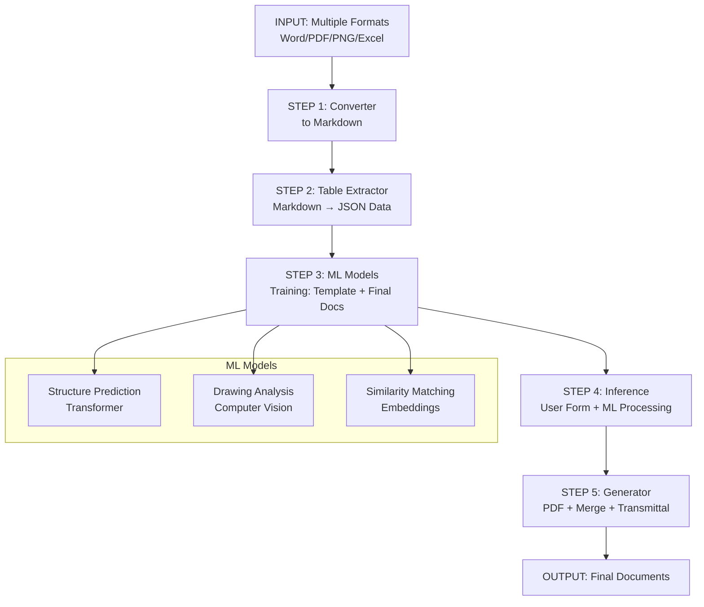

# 📊 Machine Learning Flow Diagram

## Quick Reference (Mermaid)



## 5-Step Flow

1. **File Conversion**
   - Word, PDF, PNG, Excel → Markdown
   - Extract structured data

2. **Data Table Creation**
   - Markdown → JSON tables
   - Normalize variables

3. **ML Training**
   - Client templates + final docs
   - Train models

4. **ML Inference**
   - User input → ML processing
   - Generate document structure

5. **Document Assembly**
   - Fill template with ML output
   - Generate PDF + Transmittal

---

## File Format Conversion Matrix

| Source Format | Tool | Output | Use For |
|---------------|------|--------|---------|
| Word (.docx) | python-docx | Markdown | Templates, Cover |
| PDF (.pdf) | pdfplumber + OCR | Markdown | Final docs, Drawings |
| Excel (.xlsx) | pandas | Markdown | Transmittal, Data sheets |
| Image (PNG) | OCR (tesseract) | Text/Markdown | Drawing analysis |
| DWG (cad) | cad2gcode/convert | PDF | Technical drawings |

---

## Variable Extraction Patterns

**Document Variables:**
```
{{DOC_NUMBER}}     → ELK-2024-01-15
{{TITLE}}         → Drawing for ACB Installation
{{CATEGORY}}      → Drawing
{{REVISION}}      → Rev A
{{DATE}}          → 2024-10-20
{{CLIENT}}        → PT Maju Bersama
```

**Technical Variables:**
```
{{COMPONENT}}     → ACB/ Trafo/ Switch
{{VOLTAGE}}       → 415V / 6 kV
{{CURRENT}}       → 1000A / 1250A
{{POWER}}         → 500kVA
{{FREQUENCY}}     → 50 Hz / 60 Hz
```

---

## ML Training Dataset Requirements

### Minimum Dataset:
- 50+ client templates (Word/PDF)
- 100+ final approved documents
- 50+ revised versions
- 25+ transmittal records

### Annotation Tasks:
1. Tag all template variables
2. Map variables to document fields
3. Label drawing technical specs
4. Tag revision history entries

---

## Expected Accuracy Targets

| Component | Target Accuracy | Notes |
|-----------|-----------------|-------|
| Document Structure | 95% | Template matching |
| Variable Extraction | 98% | Pattern-based |
| Content Generation | 90% | Based on templates |
| Drawing Analysis | 85% | OCR + CV |
| Similar Document Finding | 92% | Embedding similarity |

---

## Data Flow Visualization

```
CUSTOMER INPUT
┌─────────────────────────────────────────┐
│ PO Requirements:                        │
│ - ACB 1000A 415V                        │
│ - Drawing number: ELK-001               │
│ - Deadline: 2024-10-25                    │
└─────────────────────────────────────────┘
           │
           ▼
ML PROCESSING
┌─────────────────────────────────────────┐
│ Input: User Form Data                   │
│ Processing:                             │
│ 1. Match to best template              │
│ 2. Extract features from requirements   │
│ 3. Generate content blocks             │
│ 4. Create drawing list                  │
└─────────────────────────────────────────┘
           │
           ▼
DOCUMENT GENERATION
┌─────────────────────────────────────────┐
│ Cover:                                  │
│ - DOC-001-24-10-15-A                    │
│ - ACB Installation Drawing              │
│                                         │
│ Content:                                │
│ - Page 1: General Specification         │
│ - Page 2: Installation Drawing Ref      │
│ - Page 3: Technical Data Sheet          │
│                                         │
│ Output:                                 │
│ - Drawing.pdf                           │
│ - Cover.pdf                             │
│ - Merged.pdf                            │
│ - Transmittal.pdf                       │
└─────────────────────────────────────────┘
           │
           ▼
FINAL OUTPUT
┌─────────────────────────────────────────┐
│ Ready for Client Delivery               │
│ - Document accuracy: ✓                  │
│ - Format compliance: ✓                  │
│ - Revision tracking: ✓                    │
└─────────────────────────────────────────┘
```